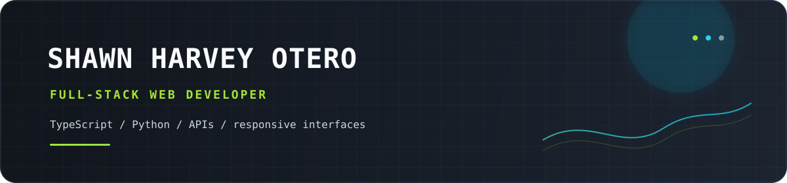

  

<table width="100%">
  <tr>
    <td width="42%" valign="top">
      <h1>Build what people can use.</h1>
      
Full-stack web developer from Bohol, Philippines. I turn real requirements into maintainable products, APIs, and responsive interfaces.

      

        
        
      

      

    </td>
    <td width="58%" valign="top">
      
01 — PROFILE SIGNAL

      <h2>Useful systems. <em>Clear interfaces.</em></h2>
      <table width="100%">
        <tr>
          <td align="center" width="33%"><h3>21</h3>public repositories</td>
          <td align="center" width="33%"><h3>TS</h3>primary build language</td>
          <td align="center" width="33%"><h3>PH</h3>Bohol, Philippines</td>
        </tr>
      </table>
    </td>
  </tr>
</table>

## What I build

<table width="100%">
  <tr>
    <td width="50%" valign="top">
      <h3>Structured products</h3>
      
Content management systems, publishing workflows, and operational tools that keep information useful.

    </td>
    <td width="50%" valign="top">
      <h3>Reliable interfaces</h3>
      
Backend APIs and data-driven web interfaces with clear contracts from database to browser.

    </td>
  </tr>
</table>

## Experience and education

<table width="100%">
  <tr>
    <td width="52%" valign="top">
      <h3>Experience</h3>
      
<strong>Web Developer Intern</strong> 
      ACE Medical Center - Bohol 
      February 2026 – May 2026

      <ul>
        <li>Contributed to a business content management system for marketing content and internal article management.</li>
        <li>Developed backend features with TypeScript, NestJS, GraphQL, Apollo, Prisma, and PostgreSQL.</li>
        <li>Implemented article and category management, database relationships, testing, and debugging.</li>
      </ul>
    </td>
    <td width="48%" valign="top">
      <h3>Education</h3>
      
<strong>Bachelor of Science in Information Technology</strong> 
      Cum Laude 
      Bohol Island State University - Balilihan Campus

      <h3>Languages</h3>
      
English · Bisaya · Filipino

    </td>
  </tr>
</table>

## Stack

<strong>Languages</strong> &nbsp;the primitives 
  &nbsp;&nbsp;
  &nbsp;&nbsp;
  &nbsp;&nbsp;
  

<strong>Frontend</strong> &nbsp;the visible layer 
  &nbsp;&nbsp;
  &nbsp;&nbsp;
  &nbsp;&nbsp;
  &nbsp;&nbsp;
  

<strong>Backend</strong> &nbsp;the service layer 
  &nbsp;&nbsp;
  &nbsp;&nbsp;
  

<strong>Data &amp; APIs</strong> &nbsp;the connective tissue 
  &nbsp;&nbsp;
  &nbsp;&nbsp;
  &nbsp;&nbsp;
  &nbsp;&nbsp;
  

<strong>Tools &amp; workflow</strong> &nbsp;the daily loop 
  &nbsp;&nbsp;
  &nbsp;&nbsp;
  

## GitHub signals

A compact read on activity, language mix, streaks, and contribution rhythm - kept inside the same navy, lime, and cyan visual system.

<table width="100%">
  <tr>
    <td width="50%" valign="top">
      
    </td>
    <td width="50%" valign="top">
      
    </td>
  </tr>
</table>

  

<table width="100%">
  <tr>
    <td width="33%" valign="top">
      
    </td>
    <td width="33%" valign="top">
      
    </td>
    <td width="33%" valign="top">
      
    </td>
  </tr>
</table>

  

3D CONTRIBUTION PROFILE / BRAND REMAP

  

## Contribution trail

Every square is real contribution data. Empty cells stay quiet, activity runs from deep cyan to ice, and the snake carries the lime accent across the grid.

  <picture>
    <source media="(prefers-color-scheme: dark)" srcset="./dist/github-contribution-grid-snake-dark.svg" />
    <source media="(prefers-color-scheme: light)" srcset="./dist/github-contribution-grid-snake.svg" />
    
  </picture>

  

  <a href="mailto:oteroshawnharvey@gmail.com">Let's build something useful.</a>

