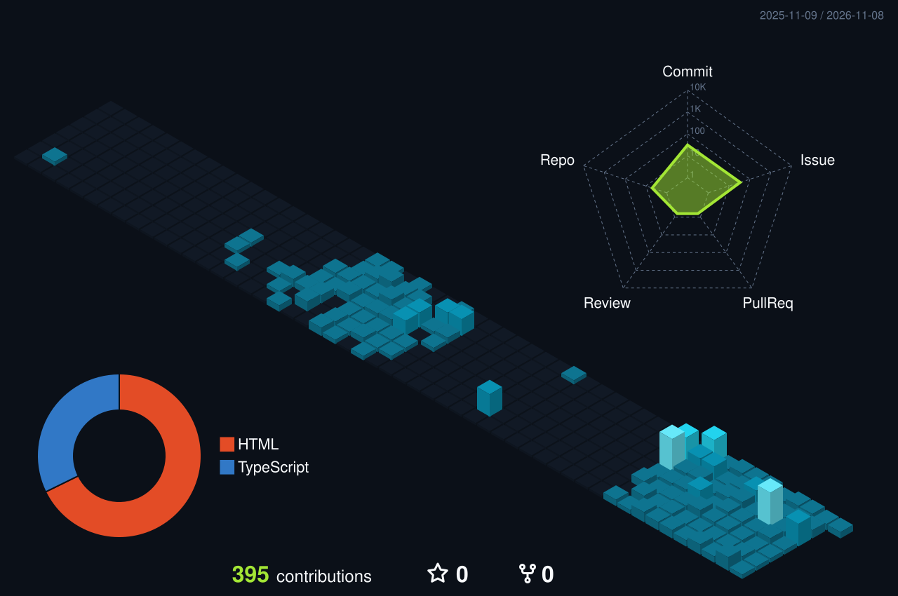
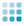

  

  

  
  &nbsp;&nbsp;&nbsp;
  
  &nbsp;&nbsp;&nbsp;
  

  

##  Tech Stack

<!-- Icons from https://github.com/tandpfun/skill-icons (MIT), vendored locally via scripts/generate-strips.ps1 with a fixed 8.25px gap baked into each strip -->

<strong>Languages</strong>

  <picture>
    <source media="(prefers-color-scheme: dark)" srcset="./assets/stack-languages-dark.svg" />
    <source media="(prefers-color-scheme: light)" srcset="./assets/stack-languages-light.svg" />
    
  </picture>

<strong>Frontend</strong>

  <picture>
    <source media="(prefers-color-scheme: dark)" srcset="./assets/stack-frontend-dark.svg" />
    <source media="(prefers-color-scheme: light)" srcset="./assets/stack-frontend-light.svg" />
    
  </picture>

<strong>Backend</strong>

  <picture>
    <source media="(prefers-color-scheme: dark)" srcset="./assets/stack-backend-dark.svg" />
    <source media="(prefers-color-scheme: light)" srcset="./assets/stack-backend-light.svg" />
    
  </picture>

<strong>Data &amp; APIs</strong>

  <picture>
    <source media="(prefers-color-scheme: dark)" srcset="./assets/stack-data-dark.svg" />
    <source media="(prefers-color-scheme: light)" srcset="./assets/stack-data-light.svg" />
    
  </picture>

<strong>Tools &amp; Workflow</strong>

  <picture>
    <source media="(prefers-color-scheme: dark)" srcset="./assets/stack-tools-dark.svg" />
    <source media="(prefers-color-scheme: light)" srcset="./assets/stack-tools-light.svg" />
    
  </picture>

##  GitHub Stats

<table width="100%">
  <tr>
    <td width="50%" valign="top">
      
    </td>
    <td width="50%" valign="top">
      
    </td>
  </tr>
</table>

  

<table width="100%">
  <tr>
    <td width="33%" valign="top">
      
    </td>
    <td width="33%" valign="top">
      
    </td>
    <td width="33%" valign="top">
      
    </td>
  </tr>
</table>

  

  

##  Contribution Trail

  <picture>
    <source media="(prefers-color-scheme: dark)" srcset="./dist/github-contribution-grid-snake-dark.svg" />
    <source media="(prefers-color-scheme: light)" srcset="./dist/github-contribution-grid-snake.svg" />
    
  </picture>

  

